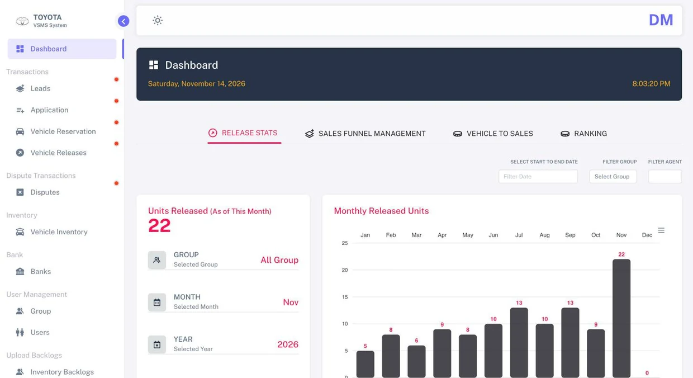
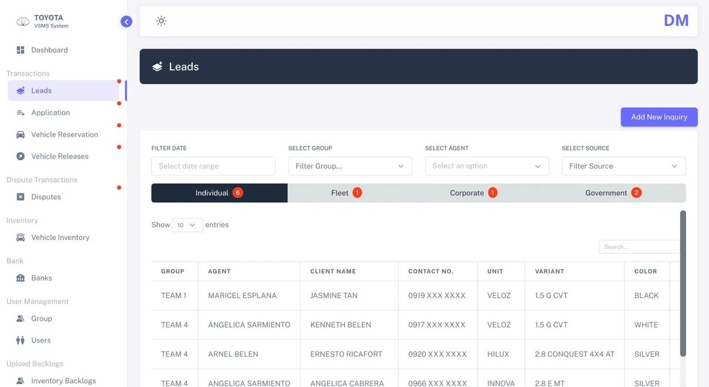
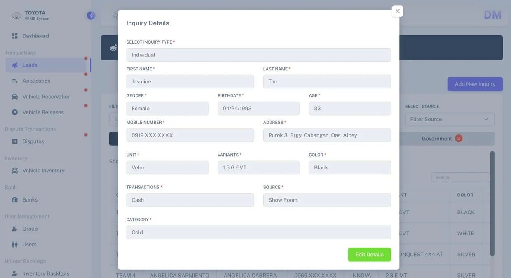
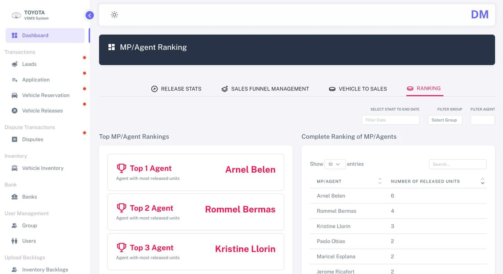

# Toyota Albay Sales CRM

**One shared sales system for a car dealership, from first lead to vehicle release.**

Toyota Albay's sales team used to track leads and vehicles across Excel files, paper forms and group chats. This system brings the whole pipeline into one place for 20–30 sales agents: inventory, leads, reservation, earmarking and releasing, with live dashboards for management.



---

## What it does

| Problem | What we built | Result |
|---|---|---|
| Leads and vehicles lived in spreadsheets, logbooks and chat messages, so no one had the full picture. | A single pipeline covering **inventory, leads, reservation, earmarking and releasing**. | Every agent works from the same up-to-date records. |
| Duplicate records led two agents to chase the same buyer, sparked commission disputes and inflated lead counts. | **One shared record per customer.** | No more double-handling, clear ownership of every sale, accurate reports. |
| Monthly and quarterly reports took days to compile by hand. | **Live dashboards** with per-agent performance tracking. | Reporting went from days to instant. Management sees results anytime. |

## Features

- **Leads pipeline** by buyer type: Individual, Fleet, Corporate and Government
- **Applications, vehicle reservations and vehicle releases**, each with status tracking
- **Disputes** tracking
- **Vehicle inventory** and **bank** records for financing
- **Dashboards:** release stats, sales funnel, vehicle-to-sales and MP/agent ranking (ApexCharts)
- **User and group management** with filters by team and agent
- **Backlog uploads** for inventory and releases

## Screenshots

| Leads pipeline | Customer inquiry record |
|---|---|
|  |  |

| Per-agent sales ranking |
|---|
|  |

> Screenshots use generated sample data. Names, numbers and addresses are made up.

## Tech stack

- **Backend:** Laravel, PHP, MySQL
- **Frontend:** Bootstrap, jQuery, DataTables, ApexCharts
- **Design:** Figma (UI design and screen layouts)

## My role

Built by a 4-person team, **September 2024 – February 2025**, as a freelance project for Toyota Albay.

I worked as **full stack developer and UI/UX lead**:

- Mapped the sales process flow and designed the database
- Set the UI design and screen layouts the whole team built on
- Built across the frontend and backend
- Joined client meetings with Toyota executives to gather requirements and present progress

The system was delivered on schedule, and management gave positive feedback after launch.

## Running it locally

Requirements: PHP 8.2+, Composer, Node.js and MySQL.

```bash
git clone https://github.com/thomasAllene/Toyota_Albay_CRM_System.git
cd Toyota_Albay_CRM_System

composer install
npm install && npm run build

cp .env.example .env      # then set your local database name, user and password
php artisan key:generate
php artisan migrate --seed # creates the tables and a year of sample data

php artisan serve
```

Then open http://127.0.0.1:8000 and sign in with a sample account:

| Role | Email | Password |
|---|---|---|
| Manager (full access) | `demo@toyotaalbay.test` | `password` |
| Sales agent | `agent1@toyotaalbay.test` | `password` |

The seeder creates 10 sample agents (`agent1` to `agent10`) with about 250 leads and 150 applications spread from January to today, so every dashboard and table has data. All names, numbers and addresses are made up.

---

**Portfolio:** [thomasallene.github.io/thomas-2026-portfolio](https://thomasallene.github.io/thomas-2026-portfolio/projects/toyota-albay-crm)
